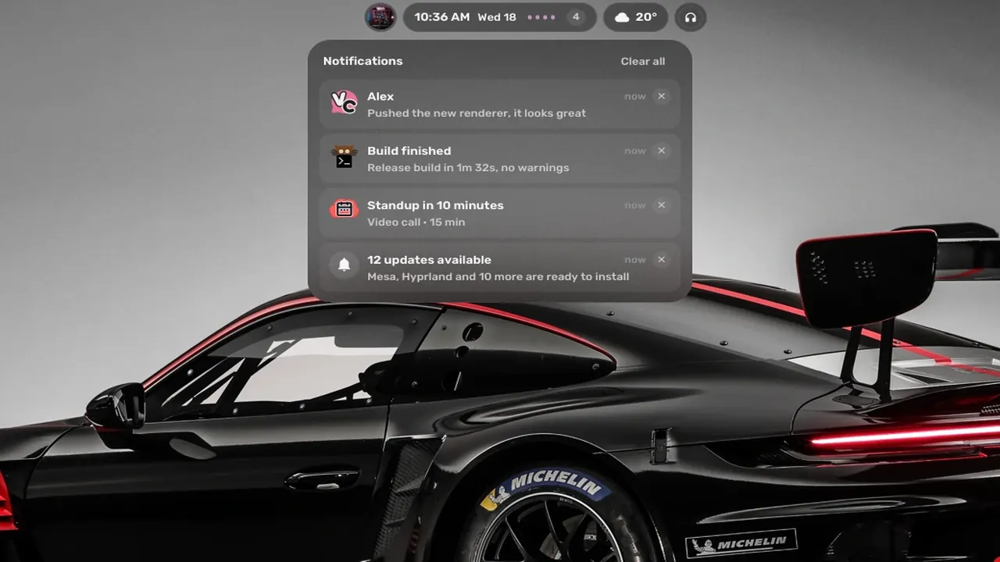
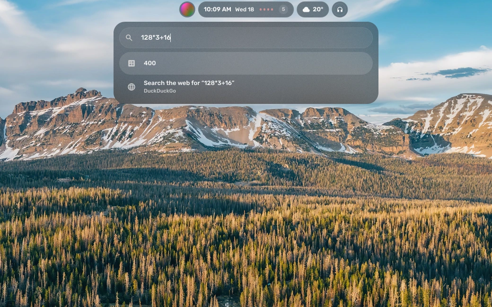
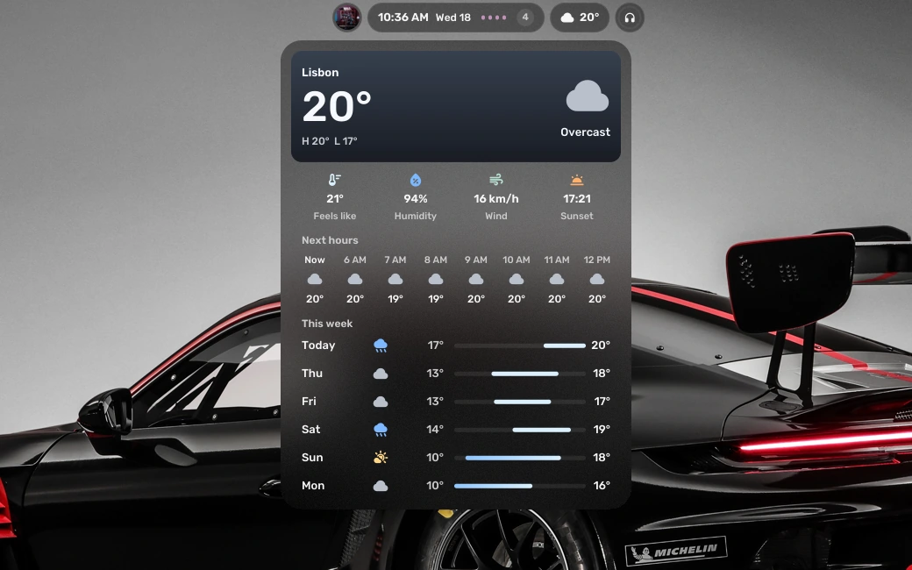

<div align="center">

# kestrel

**A desktop shell for Hyprland, built in Rust from the protocol up.**


</div>

<table>
  <tr>
    <td width="33%"><br><sub><b>Control centre</b></sub></td>
    <td width="33%"><br><sub><b>Music</b></sub></td>
    <td width="33%"><br><sub><b>Notifications</b></sub></td>
  </tr>
  <tr>
    <td><br><sub><b>Launcher</b></sub></td>
    <td><br><sub><b>File picker</b></sub></td>
    <td><br><sub><b>Capture</b></sub></td>
  </tr>
  <tr>
    <td><br><sub><b>Weather</b></sub></td>
    <td><br><sub><b>Calendar</b></sub></td>
    <td><br><sub><b>Emoji</b></sub></td>
  </tr>
</table>

## Under the hood

```
Wayland    layer-shell · session-lock · data-control
           toplevel-export · cursor-shape
D-Bus      NetworkManager · BlueZ · UPower · logind
           systemd · UDisks2 · MPRIS · polkit
Audio      PipeWire · libpulse
Hyprland   IPC socket
Serves     notifications · StatusNotifier · polkit agent
           secret agents · xdg-desktop-portal
```

- **Direct.** Core services talk to the real interfaces, not to command-line tools.
- **Truth over events.** Signals only say "read again"; state always comes from the source.
- **Supervised.** Services restart on failure, with backoff. `kestrel health` shows each one.
- **Isolated.** Password and pairing prompts run in their own process.
- **Patched renderer.** tiny-skia on the CPU, with 28 patches to iced and its layer-shell runtime
  ([vendor/](vendor/README.md)): no redraw without change, damage-only repaint, triple buffering.
- **Deterministic.** 384 tests, including seeded simulations that replay any failure exactly.
- **One design system.** A single token set, enforced by lint.

| Panel open | Wake-ups at rest | CPU at rest | Memory |
|---|---|---|---|
| 7–9 ms | 3–5 / s | ~0.3 % | ~90 MB |

## Install

Hyprland 0.56+ with the Lua config. Arch Linux:

```sh
git clone https://github.com/YashwanthKamireddi/kestrel-shell && cd kestrel-shell
make install
systemctl --user enable --now kestrel kestrel-prompt
```

[Customize](docs/CUSTOMIZE.md) · [Bar](docs/BAR.md) · [Architecture](docs/ARCHITECTURE.md) · [Design](docs/DESIGN.md) · [MIT](LICENSE)
