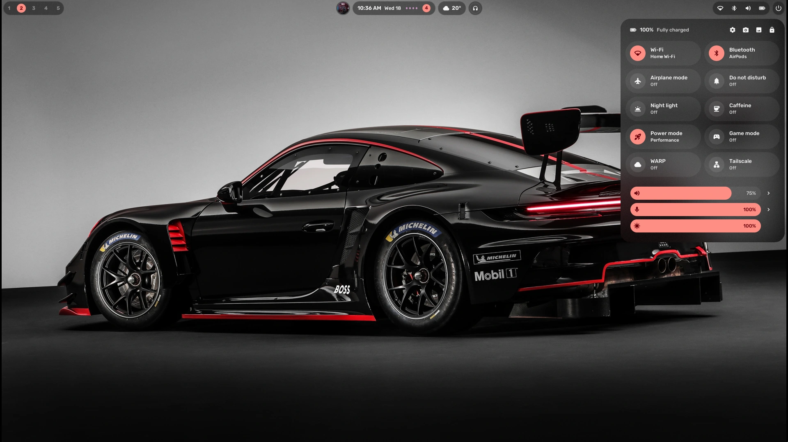
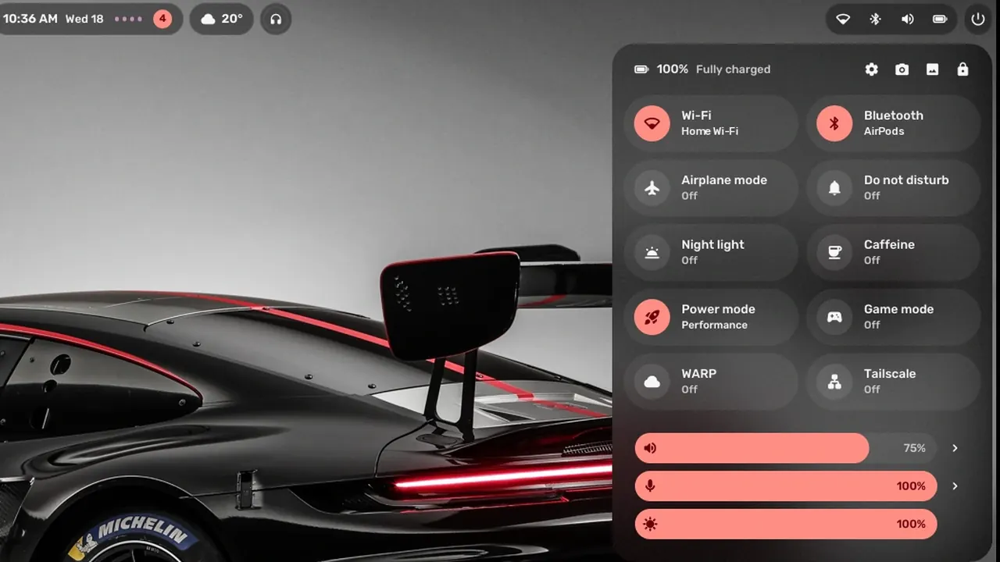
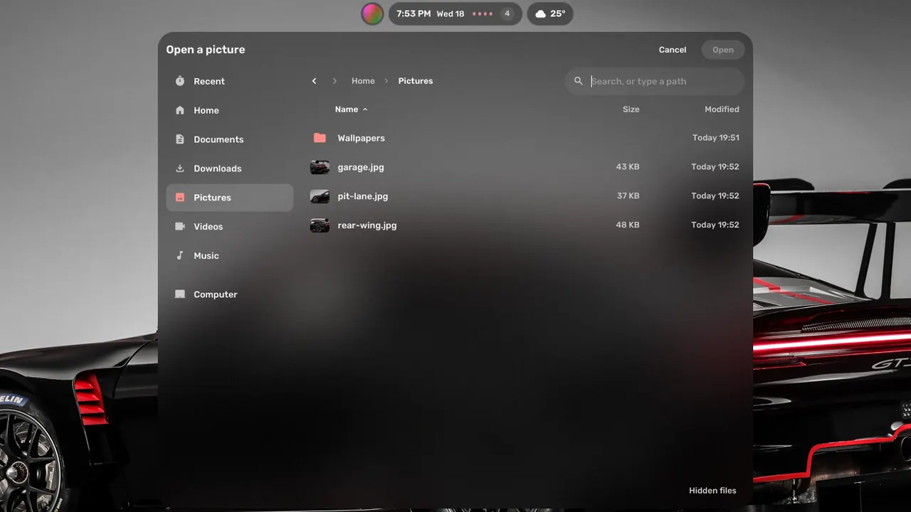
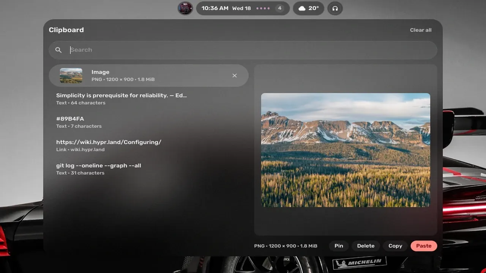
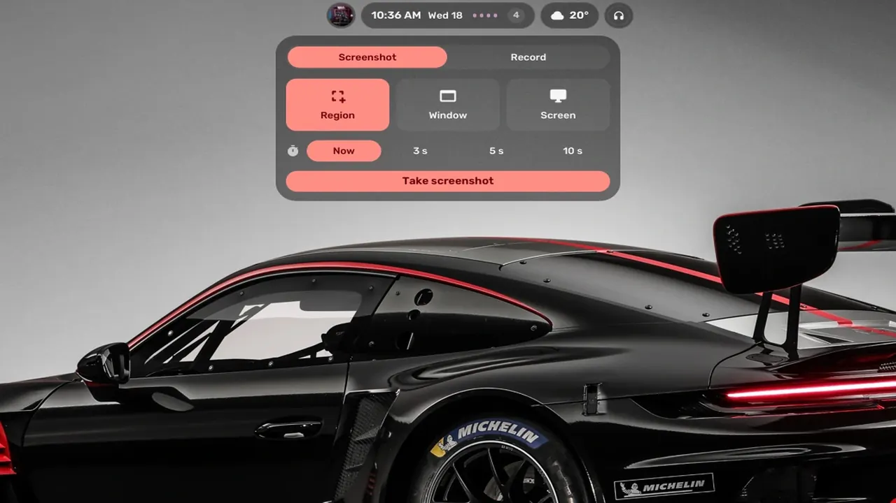
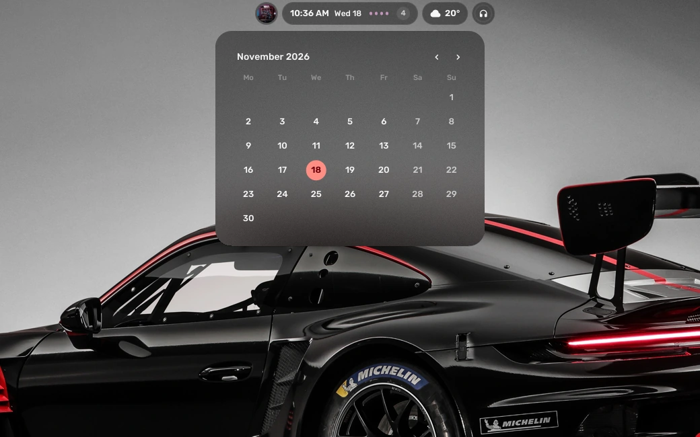
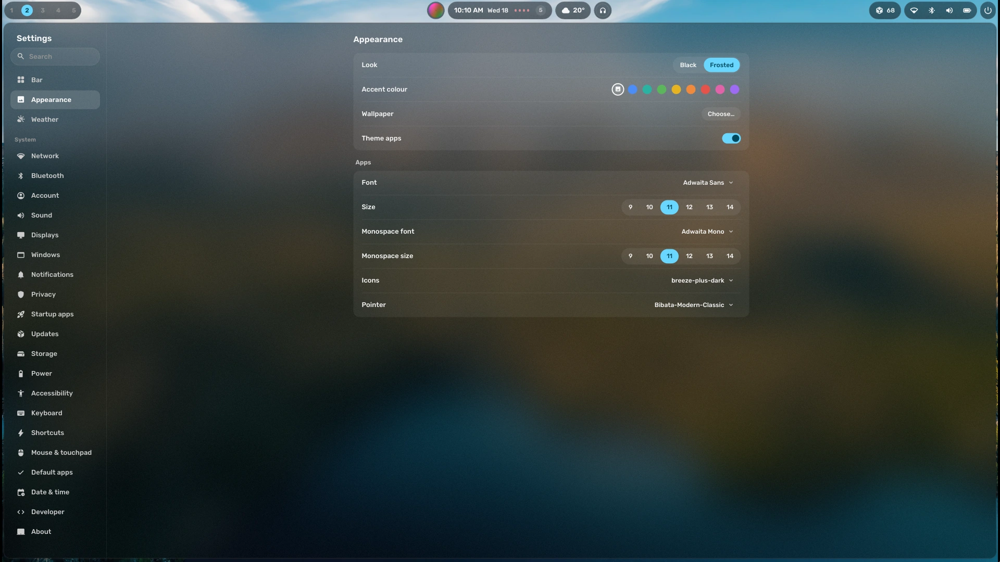
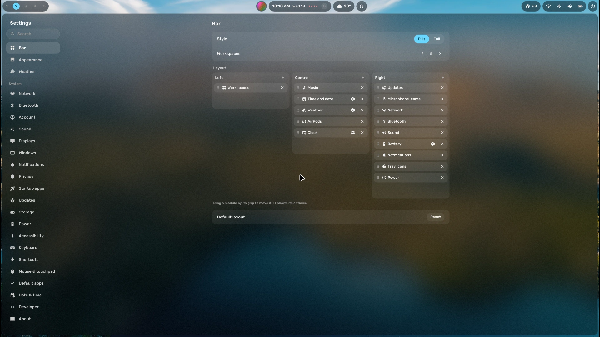

<div align="center">

# kestrel

**A desktop shell for Hyprland, written in Rust.**

The bar, island, control centre, launcher, notifications, clipboard, file picker and settings,
plus the system prompts a desktop depends on. One native binary that talks straight to the
system's own interfaces.

[Screenshots](#screenshots) · [How it works](#how-it-works) · [Numbers](#numbers) · [Install](#install) · [Docs](#docs)

<br>



</div>

<br>

## Screenshots

<table>
  <tr>
    <td width="50%"><br><sub><b>Control centre</b> · Wi-Fi, Bluetooth, modes, sliders</sub></td>
    <td width="50%"><br><sub><b>Emoji</b> · search and categories</sub></td>
  </tr>
  <tr>
    <td width="50%"><br><sub><b>Music</b> · cover, controls, live visualiser</sub></td>
    <td width="50%"><br><sub><b>Notifications</b> · grouped, with history</sub></td>
  </tr>
  <tr>
    <td><br><sub><b>File picker</b> · the portal's, for every app</sub></td>
    <td><br><sub><b>Clipboard</b> · text, links and images</sub></td>
  </tr>
  <tr>
    <td><br><sub><b>Launcher</b> · apps, files, maths, settings</sub></td>
    <td><br><sub><b>Capture</b> · screenshots and recording</sub></td>
  </tr>
  <tr>
    <td><br><sub><b>Weather</b> · hours and week</sub></td>
    <td><br><sub><b>Calendar</b></sub></td>
  </tr>
  <tr>
    <td><br><sub><b>Settings</b> · shell, Hyprland and system</sub></td>
    <td><br><sub><b>Bar editor</b> · drag between lanes</sub></td>
  </tr>
</table>

<br>

## How it works

```
 kestrel                                      kestrel prompt
 ┌──────────────────────────────────────┐     ┌──────────────────────┐
 │ surfaces   bar · island · panels      │     │ polkit · Wi-Fi ·     │
 │ kit        tokens · controls · motion │     │ Bluetooth · keyring  │
 ├──────────────────────────────────────┤     └──────────┬───────────┘
 │ services   supervised streams         │                │
 └───┬──────────┬──────────┬──────────┬──┘                │
     │          │          │          │                   │
  Wayland     D-Bus     PipeWire   Hyprland  ◄────────────┘
  protocols   system +  libpulse   IPC socket
              session
```

**No middlemen.** The core services are clients of the real interfaces, not wrappers around
command-line tools (a few edge features still call one where it is the only interface, such
as `pkexec`, `warp-cli` and `tailscale`): NetworkManager, BlueZ, UPower, logind, systemd, UDisks2, timedated, MPRIS,
StatusNotifier and polkit over D-Bus (zbus); audio levels from PipeWire, volume through
libpulse; windows and workspaces from Hyprland's socket; the clipboard over
`wlr-data-control`; window previews over `hyprland-toplevel-export`. kestrel is also a
server: the notification daemon, the polkit and NetworkManager secret agents, the BlueZ
pairing agent, and an `xdg-desktop-portal` backend (file chooser, app chooser, settings).

**Truth over events.** A signal never carries state into the shell. It only means "look
again", and the service re-reads the whole object from its source. A dropped or reordered
signal cannot leave a wrong value on screen.

**Supervised.** Each service runs as a stream under a supervisor: a panic is caught and the
stream restarts. More than 5 failures in 60 s holds it off for 2 minutes. `kestrel health`
prints the state of every service. Password and pairing prompts live in a second process,
`kestrel prompt`, so a restarting shell never drops a polkit request.

**Rendering.** iced 0.14 on a vendored layer-shell runtime, rasterised on the CPU by tiny-skia
into shared-memory buffers. 28 documented patches (in [`vendor/`](vendor/README.md)) make it
behave like a shell instead of an app:
- a surface whose content has not changed is never redrawn;
- no frame is rasterised before the compositor can take it;
- only the damaged rectangles are repainted and reported to the compositor;
- triple buffering, so drawing never waits on the previous frame;
- the blur region is committed with its buffer;
- 8×8 anti-aliasing for clean curves.

**Never blocks the UI thread.** Disk writes go through one writer thread, and every update
that takes longer than 8 ms is logged with its name.

**Tested like a system.** There are 384 tests. Seeded deterministic simulations drive the MPRIS
and tray trackers through random sequences of players and tray items appearing, vanishing,
restarting and changing names; any failure replays exactly from its seed.
`tools/rig` runs the whole shell in a nested Hyprland with its own home directory and private
session bus, where tests can type, click and take screenshots.

**One design system.** Spacing, radii, colour and motion come from a single token set.
`make check` fails if a panel uses a literal size.

<br>

## Numbers

Release build on a mid-range 1080p laptop, Arch Linux, Hyprland 0.56.

| | |
|---|---|
| Panel open to first frame | 7–9 ms |
| Wake-ups at rest | 3–5 per second |
| CPU at rest | ~0.3 % of one core |
| Memory | ~90 MB |
| Code | ~63k lines of Rust, plus ~33k vendored |

Run with `KESTREL_TRACE=1` to log the timing of every frame and see these on your own machine.

<br>

## Install

Needs **Hyprland 0.56 or newer with the Lua config** (`~/.config/hypr/*.lua`). Packaged for
Arch Linux; elsewhere, build with Cargo.

```sh
git clone https://github.com/YashwanthKamireddi/kestrel-shell
cd kestrel-shell
make install
systemctl --user enable --now kestrel kestrel-prompt
```

Depends on `hyprland`, `pipewire`, `libpulse`, `dbus`, `ttf-rubik-vf` and `ttf-twemoji`.
Optional: `hyprsunset` for night light and `hyprlock` for locking.

<br>

## Docs

| | |
|---|---|
| [Customize](docs/CUSTOMIZE.md) | `config.toml`, Lua, commands such as `kestrel toggle launcher` |
| [Bar](docs/BAR.md) | modules and their options |
| [Architecture](docs/ARCHITECTURE.md) | how the code is organised, and its rules |
| [Design](docs/DESIGN.md) | the token set and the component kit |

```sh
make check                                      # rustfmt, design lint, clippy, tests
tools/rig/rig.sh start && tools/rig/rig.sh run  # the shell in a nested Hyprland
```

<br>

## Status

Young and used every day. Hyprland only, English only; the config format may still change.

## License

[MIT](LICENSE)
