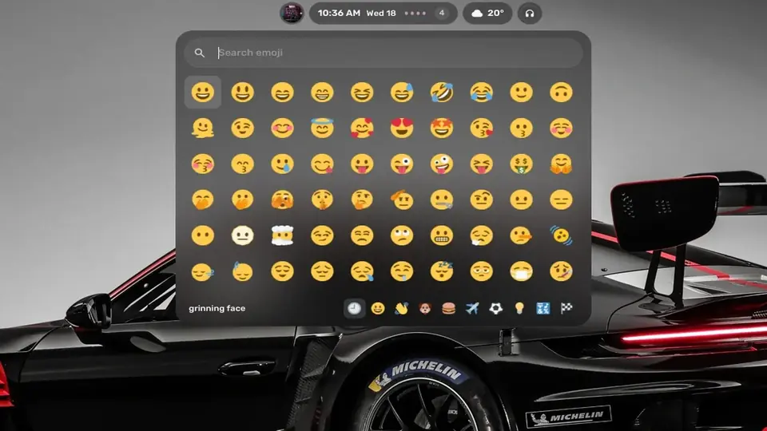

<div align="center">

# kestrel

**A native desktop shell for Hyprland, written in Rust.**

Bar, island, control centre, launcher, notifications, clipboard, settings and the system
prompts a desktop needs, in one program. No QML, GTK, Electron or JavaScript runtime.

[Screenshots](#screenshots) · [Features](#features) · [Under the hood](#under-the-hood) · [Install](#install) · [Docs](#docs)

<br>


</div>

<br>

## Screenshots

<table>
  <tr>
    <td width="50%"><br><sub><b>Music</b>: cover, progress, controls, and a live visualiser in the bar</sub></td>
    <td width="50%"><br><sub><b>Notifications</b>: grouped, actionable, kept as history</sub></td>
  </tr>
  <tr>
    <td><br><sub><b>Clipboard</b>: text, links and images, searchable, kept when the app closes</sub></td>
    <td><br><sub><b>Launcher</b>: apps, files, a calculator, settings and switches</sub></td>
  </tr>
  <tr>
    <td><br><sub><b>Weather</b>: today, the next hours and the week</sub></td>
    <td><br><sub><b>Emoji</b>: search, categories, recent</sub></td>
  </tr>
  <tr>
    <td><br><sub><b>Capture</b>: region, window or screen; screenshot or recording</sub></td>
    <td><br><sub><b>Calendar</b></sub></td>
  </tr>
  <tr>
    <td><br><sub><b>Settings</b>: one app for the shell, Hyprland and the system</sub></td>
    <td><br><sub><b>Bar editor</b>: drag modules between three lanes</sub></td>
  </tr>
</table>

<br>

## Features

- **Bar**: floating pills or a full band. Workspaces with app icons, music, weather, AirPods
  battery, tray, privacy indicator, network, Bluetooth, sound, battery, power. Arranged by
  dragging in Settings, or written in Lua.
- **Island**: the time at the centre of the bar, with music and a live visualiser, volume and
  brightness, devices connecting, recordings and copies.
- **Control centre**: Wi-Fi and Bluetooth with their own pages, airplane mode, night light,
  caffeine, power profiles, game mode, VPNs, and a sound mixer per app and per device.
- **Notifications**: grouped per app, actions, swipe to dismiss, per-app rules, Do not disturb,
  history.
- **Launcher**: apps, file search, a calculator, settings pages and quick switches. Paste a path
  and press Enter to open it.
- **Clipboard, emoji, screenshots and recording, wallpapers with colours taken from them,
  system monitor, weather, calendar, window overview, keyboard shortcut sheet.**
- **The system prompts are its own**: polkit passwords, Wi-Fi secrets, Bluetooth pairing and
  GNOME Keyring unlocks, in a separate process that keeps running if the shell restarts.
- **A desktop portal backend**: the file picker, "Open with" and the appearance apps follow
  (dark mode, accent colour) are kestrel's, for every app that asks through xdg-desktop-portal.
- **Theming other apps**: the accent and fonts reach GTK, Qt, kitty, hyprlock and starship.
- **Keyboard first**: every panel works without a mouse; Tab and the arrows move between
  controls, Enter presses.

<br>

## Under the hood

```
┌────────────────────────────────────────────────────────────────┐
│ You             ~/.config/kestrel   config.toml, init.lua (Lua) │
├────────────────────────────────────────────────────────────────┤
│ Modules         src/modules         bar items, one file each    │
│ Shell           src/shell, panels   surfaces, panels, Settings  │
│ Design kit      src/ui, src/theme   one token set, one control  │
├────────────────────────────────────────────────────────────────┤
│ Services        kestrel-services    no UI: D-Bus, PipeWire,     │
│                                     Hyprland, Wayland protocols │
└────────────────────────────────────────────────────────────────┘
   + kestrel prompt   a second process for passwords and pairing
```

- **Talks to the system directly.** NetworkManager, BlueZ, UPower, logind, MPRIS, polkit and the
  portal over D-Bus (zbus); audio through PipeWire (its Pulse protocol and native API); Hyprland
  over its socket; the clipboard over wlr data-control. No `nmcli`, `bluetoothctl` or `playerctl` behind the scenes.
- **Truth over events.** Every indicator is read from its source; a change signal only says
  "look again", so a missed event can never leave something false on screen.
- **Failures stay small.** A panel or module that panics is switched off on its own; a service
  that ends or panics is started again; the prompts live in their own process.
- **Draws only what changed.** iced 0.14 on a vendored, patched layer-shell runtime, rendered on
  the CPU with tiny-skia. A surface whose content did not change is not redrawn. Each patch and
  its reason is in [`vendor/README.md`](vendor/README.md).
- **One design system, enforced.** Spacing, radii, colours and motion come from one token set; a
  lint in `make check` fails the build when a panel uses a literal size.
- **Tested off the desktop.** `tools/rig` runs kestrel in a nested Hyprland with its own home and
  session bus, to try changes and take screenshots without touching the real session.

**Measured** on a 1080p laptop (Intel Core i5-1245U, Arch Linux, Hyprland 0.56), release build:

| | |
|---|---|
| Memory | ~90 MB (PSS) |
| Wake-ups at rest | 3–5 per second |
| CPU at rest | ~0.3 % of one core |
| CPU with music and the visualiser | ~3.6 % of one core |
| Panel opened to first frame | 7–9 ms |

One machine's numbers, not a benchmark against other shells. `KESTREL_TRACE=1` prints every
frame's timings if you want to measure your own.

<br>

## Install

kestrel needs **Hyprland 0.56 or newer with the Lua config** (`~/.config/hypr/*.lua`). It is
packaged for Arch Linux; other distributions need a manual build.

```sh
git clone https://github.com/YashwanthKamireddi/kestrel
cd kestrel
make install                                  # checks, builds, packages, installs
systemctl --user enable --now kestrel kestrel-prompt
```

Requires `hyprland`, `pipewire`, `libpulse`, `dbus`, `ttf-rubik-vf` and `ttf-twemoji`. Optional:
`hyprsunset` (night light), `hyprlock` (lock screen).

<br>

## Docs

| | |
|---|---|
| [Customize](docs/CUSTOMIZE.md) | `config.toml`, Lua, commands (`kestrel toggle launcher`, …) |
| [Bar](docs/BAR.md) | modules and their options |
| [Architecture](docs/ARCHITECTURE.md) | how the code is organised, and its rules |
| [Design](docs/DESIGN.md) | the token set and the component kit |
| [Research](docs/research/SHELLS.md) | what other shells do, read from their source |

```sh
make check                                    # rustfmt, design lint, clippy -D warnings, tests
tools/rig/rig.sh start && tools/rig/rig.sh run  # try a change in a nested Hyprland
```

<br>

## Status

A personal shell, used daily on the machine it was built on, and young. Hyprland only, English
only, and the config may still change. Issues and ideas are welcome.

## License

[MIT](LICENSE)
