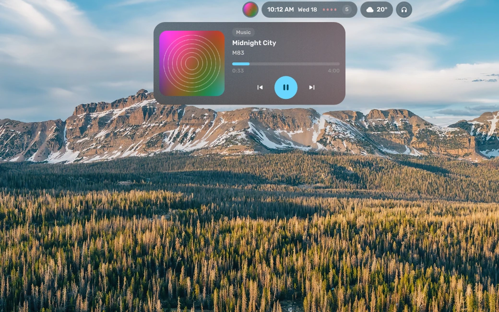

<div align="center">

# kestrel

**A desktop shell for Hyprland, written in Rust.**

One program for the bar, island, control centre, launcher, notifications, clipboard and
settings, and for the system prompts a desktop depends on.

[Screenshots](#screenshots) · [Features](#features) · [Design](#design) · [Install](#install) · [Docs](#docs)

<br>


</div>

<br>

## Screenshots

<table>
  <tr>
    <td width="50%"><br><sub><b>Music</b> · cover, controls, live visualiser</sub></td>
    <td width="50%"><br><sub><b>Notifications</b> · grouped, with history</sub></td>
  </tr>
  <tr>
    <td><br><sub><b>Clipboard</b> · text, links and images</sub></td>
    <td><br><sub><b>Launcher</b> · apps, files, maths, settings</sub></td>
  </tr>
  <tr>
    <td><br><sub><b>Weather</b> · hours and week</sub></td>
    <td><br><sub><b>Emoji</b> · search and categories</sub></td>
  </tr>
  <tr>
    <td><br><sub><b>Capture</b> · screenshots and recording</sub></td>
    <td><br><sub><b>Calendar</b></sub></td>
  </tr>
  <tr>
    <td><br><sub><b>Settings</b> · shell, Hyprland and system</sub></td>
    <td><br><sub><b>Bar editor</b> · drag between lanes</sub></td>
  </tr>
</table>

<br>

## Features

- **Bar.** Floating pills or a full band: workspaces with app icons, music, weather, AirPods,
  tray, privacy indicator, network, Bluetooth, sound, battery and power. Arranged by drag in
  Settings, or extended in Lua.
- **Island.** The clock at the centre, which also carries music with a visualiser, volume and
  brightness, devices connecting, recordings and copies.
- **Control centre.** Wi-Fi and Bluetooth with their own pages, airplane mode, night light,
  caffeine, power profiles, game mode, VPNs, and a mixer per app and per device.
- **Notifications.** Grouped per app, with actions, swipe to dismiss, per-app rules, Do not
  disturb and history.
- **Launcher.** Apps, files, a calculator, settings pages and quick switches.
- **Everything else.** Clipboard history with images, emoji, screenshots and recording,
  wallpapers that set the accent colour, system monitor, weather, calendar, window overview and
  a keyboard-shortcut sheet.
- **System prompts.** Administrator passwords, Wi-Fi secrets, Bluetooth pairing and keyring
  unlocks, in a second process that keeps running if the shell restarts.
- **Portal backend.** The file picker, "Open with" and app appearance (dark mode, accent) for
  every app that asks through xdg-desktop-portal.
- **App theming.** The accent and fonts carry over to GTK, Qt, kitty, hyprlock and starship.
- **Keyboard first.** Every panel works without a mouse: Tab and the arrows move, Enter presses.

<br>

## Design

```
┌────────────────────────────────────────────────────────────────┐
│ Config          ~/.config/kestrel   config.toml, init.lua       │
├────────────────────────────────────────────────────────────────┤
│ Modules         src/modules         bar items, one file each    │
│ Shell           src/shell, panels   surfaces, panels, Settings  │
│ Design kit      src/ui, src/theme   tokens and components       │
├────────────────────────────────────────────────────────────────┤
│ Services        kestrel-services    D-Bus, PipeWire, Hyprland,  │
│                                     Wayland protocols; no UI    │
└────────────────────────────────────────────────────────────────┘
  kestrel prompt    a separate process for passwords and pairing
```

- **Direct system access.** NetworkManager, BlueZ, UPower, logind, MPRIS, polkit and the portal
  over D-Bus; audio through PipeWire; Hyprland over its socket; the clipboard over wlr
  data-control. Nothing shells out to `nmcli`, `bluetoothctl` or `playerctl`.
- **Truth over events.** Every indicator is read from its source. A change signal only means
  "read again", so a missed event cannot leave something wrong on screen.
- **Contained failures.** A panel or module that panics is switched off on its own; a service
  that stops or panics is restarted; the prompts live in their own process.
- **Minimal drawing.** iced 0.14 on a vendored layer-shell runtime, rendered with tiny-skia.
  A surface whose content has not changed is not redrawn. Every patch to the vendored code is
  documented in [`vendor/README.md`](vendor/README.md).
- **One design system.** Spacing, radii, colour and motion come from a single token set, and
  `make check` fails on any literal size in a panel.
- **Isolated testing.** `tools/rig` runs the shell in a nested Hyprland with its own home and
  session bus, so changes are tried and photographed away from the real session.

### Measurements

1080p laptop, Intel Core i5-1245U, Arch Linux, Hyprland 0.56, release build.

| | |
|---|---|
| Memory | ~90 MB |
| Wake-ups at rest | 3–5 per second |
| CPU at rest | ~0.3 % of a core |
| Panel open to first frame | 7–9 ms |

`KESTREL_TRACE=1` prints every frame's timings to measure your own.

<br>

## Install

Requires **Hyprland 0.56 or newer with the Lua config** (`~/.config/hypr/*.lua`). Packaged for
Arch Linux; elsewhere, build with Cargo.

```sh
git clone https://github.com/YashwanthKamireddi/kestrel-shell
cd kestrel-shell
make install
systemctl --user enable --now kestrel kestrel-prompt
```

Depends on `hyprland`, `pipewire`, `libpulse`, `dbus`, `ttf-rubik-vf` and `ttf-twemoji`;
optionally `hyprsunset` for night light and `hyprlock` for the lock screen.

<br>

## Docs

| | |
|---|---|
| [Customize](docs/CUSTOMIZE.md) | `config.toml`, Lua, commands such as `kestrel toggle launcher` |
| [Bar](docs/BAR.md) | modules and their options |
| [Architecture](docs/ARCHITECTURE.md) | how the code is organised, and its rules |
| [Design](docs/DESIGN.md) | the token set and the component kit |
| [Research](docs/research/SHELLS.md) | what other shells do, read from their source |

```sh
make check                                      # rustfmt, design lint, clippy, tests
tools/rig/rig.sh start && tools/rig/rig.sh run  # run a change in a nested Hyprland
```

<br>

## Status

Young and used daily. Hyprland only, English only; the config format may still change.

## License

[MIT](LICENSE)
